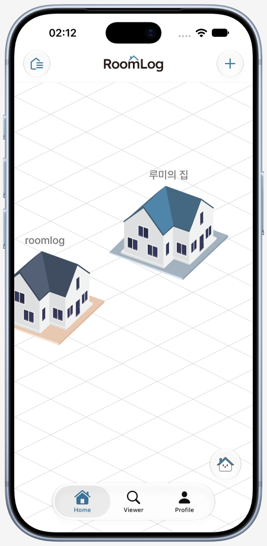
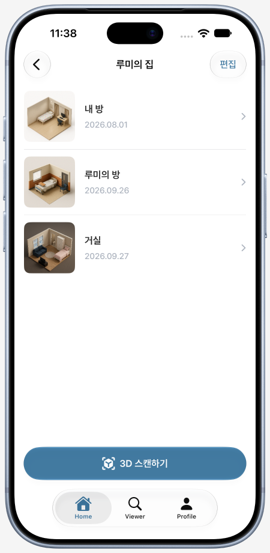
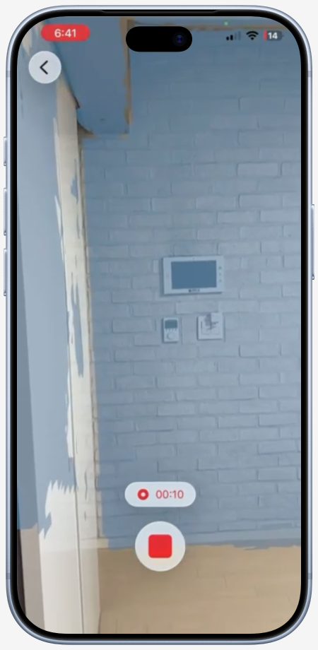
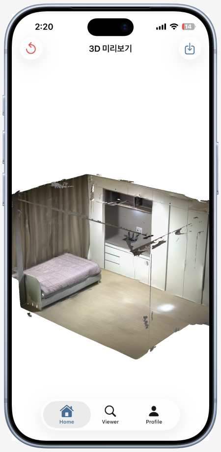
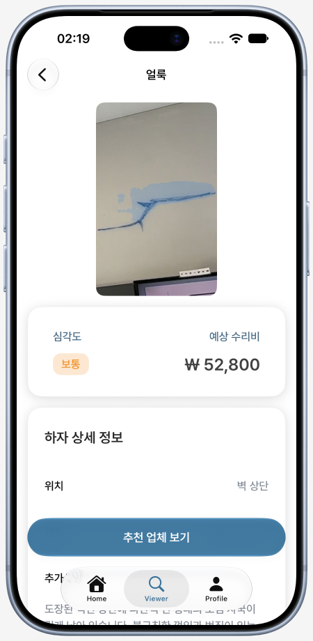
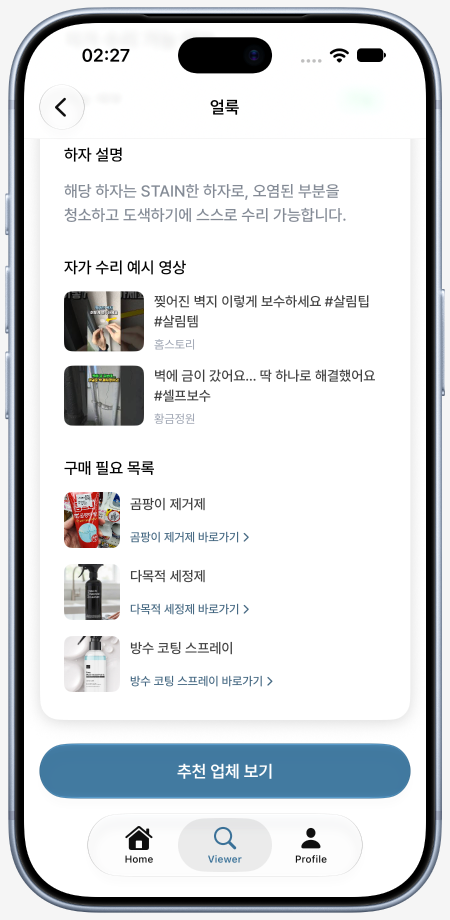
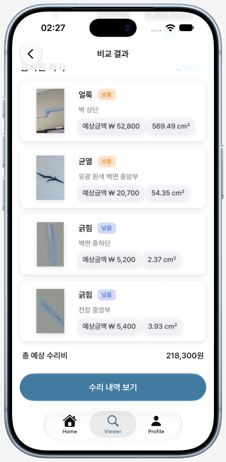
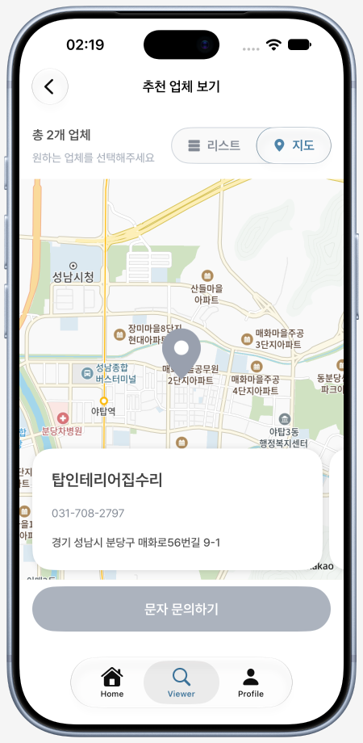
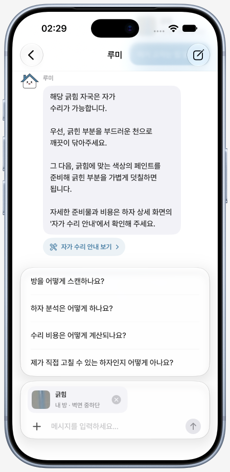

# RoomLog

> 자취/원룸 거주자를 위한 **3D 방 기록 & 하자 관리 iOS 앱**
> 2026 한이음 드림업 프로젝트 (Team 404)

LiDAR 기반 3D 스캔으로 입주 시점의 방을 기록하고, 퇴거 시 동일 공간을 다시 스캔해 두 시점의 모델과 서버가 분석한 하자를 비교·관리하는 iOS 앱입니다. 하자별 예상 수리비와 자가 수리 안내, 주변 수리업체 문의, 챗봇 루미를 통한 상담까지 지원합니다.

## 👥 Team

| <a href="https://github.com/ddodle"></a> | <a href="https://github.com/wk1717"></a> |
|:---:|:---:|
| **김도연** | **송민교** |
| iOS | iOS |
| Auth · Home · Scan · Chatbot · MyPage<br/>Core (NetworkClient · TokenStore · DIContainer · CI) | Viewer · Defect · Comparison · Estimate |
| [@ddodle](https://github.com/ddodle) | [@wk1717](https://github.com/wk1717) |

## ✨ 주요 기능

| 기능 | 설명 |
|------|------|
| **인증 (Auth)** | 이메일/비밀번호 기반 회원가입·로그인. Access/Refresh 토큰은 Keychain에 저장하고, 인증이 필요한 요청에서 401 응답을 받으면 토큰을 갱신한 뒤 재요청합니다. |
| **홈 (Home)** | 등록한 집을 자체 **isometric 캔버스**에 시각화. 줌·팬·자동 가장자리 스크롤과 zoom 트랜지션을 지원하며, 집별 방 목록과 입주·퇴거 정보를 관리합니다. |
| **3D 스캔 (Scan)** | LiDAR(ARKit)로 방 내부를 녹화하고, **Depth / Confidence / IMU / Odometry / Video** 데이터와 JPEG 키프레임을 기록합니다. ZIP 패키징·서버 업로드 후 처리 상태 확인과 단계별 재시도를 지원합니다. |
| **3D 뷰어 (Viewer)** | 서버에서 처리된 USDZ 모델을 **SceneKit**으로 표시해 방 내부를 확대·회전하며 둘러봅니다. 모델은 로컬에 캐시되어 재진입 시 재사용됩니다. |
| **하자 점검 (Defect)** | 3D 좌표가 있는 하자를 태그로 표시하고, 선택한 위치로 카메라를 이동합니다. 하자 유형·심각도·예상 수리비·자가 수리 가능 여부를 확인하고, 제공되는 수리 영상·준비물을 살펴봅니다. |
| **내방비교 (Comparison)** | 이전·이후 방 기록을 선택해 분석을 요청합니다. 두 시점의 USDZ 모델을 토글하며 비교하고, 결과의 하자 목록과 총 예상 수리비를 확인합니다. |
| **수리 견적 (Estimate)** | 추천 수리업체를 목록과 **KakaoMapsSDK** 지도에서 확인합니다. 문의 내용을 확인한 뒤 문자 전송을 지원하는 기기에서 SMS 작성 화면으로 연결하고, 수리 내역에 실제 수리비와 메모를 기록합니다. |
| **챗봇 루미 (Chatbot)** | 앱 사용법과 하자를 질문하고, 대표 집의 하자를 첨부해 상담합니다. 추천 질문·대화 복원·전송 재시도를 지원하며, 자가 수리 안내가 포함된 답변에서 해당 하자의 안내 화면으로 이동할 수 있습니다. |
| **마이페이지 (MyPage)** | 닉네임 변경, 로그아웃, 회원 탈퇴를 지원합니다. |

## 📸 Screenshots

주요 화면 예시입니다. 촬영 시점과 데이터에 따라 현재 실행 화면과 차이가 있을 수 있습니다.

<table>
  <tr>
    <th align="center">집 관리</th>
    <th align="center">방 기록</th>
    <th align="center">LiDAR 스캔</th>
  </tr>
  <tr>
    <td align="center"></td>
    <td align="center"></td>
    <td align="center"></td>
  </tr>
  <tr>
    <th align="center">3D 미리보기</th>
    <th align="center">하자 상세</th>
    <th align="center">자가 수리 안내</th>
  </tr>
  <tr>
    <td align="center"></td>
    <td align="center"></td>
    <td align="center"></td>
  </tr>
  <tr>
    <th align="center">방 비교 결과</th>
    <th align="center">수리업체 지도</th>
    <th align="center">챗봇 루미</th>
  </tr>
  <tr>
    <td align="center"></td>
    <td align="center"></td>
    <td align="center"></td>
  </tr>
</table>

## 🚀 사용 기술

### 1. Swift Concurrency 기반 동시성 안전한 인증 파이프라인

- **`NetworkClient` (actor)** — 인증이 필요한 요청의 401 응답에 대해 토큰 갱신 후 재요청하며, 기본 재시도 횟수는 1회입니다. **갱신 중 들어오는 요청은 같은 `Task<TokenPair, Error>`의 결과를 기다려** 진행 중인 토큰 갱신을 공유합니다.
- **`KeychainTokenStore` (actor)** — Access/Refresh 토큰을 `kSecAttrAccessibleAfterFirstUnlockThisDeviceOnly`로 Keychain에 저장하며, 읽기·쓰기·삭제를 actor 내부에서 처리합니다.
- **`AuthenticationPolicy` 추상화** — 요청별 인증 필요 여부와 401 판단 로직을 분리합니다. 기본 정책에서 `/auth` 경로는 자동 토큰 갱신 대상에서 제외됩니다.

### 2. 백그라운드 연장·재시작 복구를 지원하는 스캔 파이프라인

`ScanProcessingManager`는 `압축 → 업로드 → 상태 폴링 → 프리뷰 다운로드`의 4단계를 하나의 처리 `Task`로 관리하고, 단계별 상태와 복구 정보를 보관합니다.

- **앱 재시작 복구** — 진행 단계를 `ScanArtifactStore`가 Codable 단일 레코드(`uploadReady` / `polling`)로 저장하며, 업로드 성공 시 `polling`으로 전환합니다. 재실행 시 폴링 기록은 상태 조회를 재개하고, 업로드 미완 기록은 ZIP 파일이 남아 있으면 재시도 가능한 실패 상태로 복원합니다.
- **zip 영속화** — zip은 Application Support의 영속 디렉터리에 두고(백업 제외) 기록에는 파일명만 저장해 컨테이너 경로가 바뀌어도 복원됩니다. 기록에 없는 zip·데이터셋은 재실행 시 고아 청소로 정리합니다.
- **백그라운드 연장** — 촬영 완료·업로드 재시도로 시작한 처리는 `BGContinuedProcessingTask`로 실행 연장을 요청하고, 진행률과 단계 문구를 표시합니다. 서버 처리 단계의 진행률은 폴링 횟수 기반 추정값입니다. 연장이 종료되어 앱이 일시 중지되면 폴링은 복귀 후 계속하며, 연결이 끊긴 업로드는 실패 상태에서 재시도할 수 있습니다. 알림 권한을 허용한 경우 USDZ 프리뷰 다운로드 완료를 로컬 알림으로 안내하고, 알림을 누르면 해당 집의 방 목록과 스캔 상태 시트로 이동합니다.
- **실패 지점별 재시도** — `RetrySource`(upload / polling / download)로 재시도 진입점을 구분합니다. 재시도 가능한 업로드 실패는 ZIP을, 폴링·다운로드 실패는 서버 `scanId`를 보존하며, 재시도 불가 실패는 기록과 ZIP을 폐기합니다. 인코딩·압축 실패는 재촬영이 필요합니다.
- **Cross-house 격리** — 기록과 활성 스캔이 `houseId`를 함께 들고 있어 다른 집의 스캔과 섞이지 않습니다.
- **폴링** — 기본 설정은 상태 조회 사이에 7초 대기, 최대 60회 시도이며, 조회 오류가 3회 연속 발생하면 실패 상태로 전환합니다. 폴링 타임아웃은 서버 스캔을 취소하지 않고 재폴링 가능한 실패로 남깁니다.
- **취소 처리** — 비동기 단계 전후에 취소 여부를 확인해 취소된 작업의 늦은 결과가 다음 단계로 진행하거나 완료 상태를 되살리지 않도록 합니다. 압축 도중 취소되면 압축 작업이 끝난 뒤 산출물을 정리합니다.

### 3. ARKit 멀티 채널 스캔 데이터 인코딩

`DatasetEncoder`는 한 번의 녹화 세션에서 5종류의 시계열 데이터와 JPEG 키프레임·CSV 메타데이터를 기록합니다.
인코더 구현은 [Stray Scanner](https://github.com/strayrobots/scanner)(MIT License)를 기반으로 이식했습니다.

| 채널 | 데이터 | 인코더 |
|------|--------|--------|
| RGB Video | `ARFrame.capturedImage` | `VideoEncoder` (HEVC/H.265) |
| Depth | `ARFrame.sceneDepth.depthMap`, 밀리미터 단위 16비트 PNG | `DepthEncoder` |
| Confidence | `ARFrame.sceneDepth.confidenceMap`, 8비트 PNG | `ConfidenceEncoder` |
| Odometry | `ARFrame.camera.transform` | `OdometryEncoder` |
| IMU | `CMMotionManager` 가속도·자이로 | `IMUEncoder` |
| Keyframe | RGB 키프레임 JPEG 및 촬영 시각·카메라 내부 파라미터·노출·각속도 CSV | `KeyframeEncoder` |

`NSLock`으로 IMU 공유 상태를 동기화하고, `Mutex`로 대기 중인 프레임·키프레임 수를 관리합니다. `frameInterval` 기반 프레임 다운샘플링과 대기량 초과 시 프레임 드롭을 지원하며, 기록된 데이터셋은 `ScanProcessingManager`에서 `ZIPFoundation`으로 압축해 서버에 전송합니다.

### 4. Observation 매크로와 SwiftUI Environment 기반 DI

- 모든 ViewModel과 공유 상태(`HomeState`, `ScanProcessingManager`)에 **`@Observable` 매크로** 적용
- `DIContainer`는 `ObjectIdentifier` 기반으로 의존성을 지연 생성하고 컨테이너 내에서 인스턴스를 재사용하며, 전체·특정 타입의 캐시 무효화(`resetCache`)를 지원
- SwiftUI `Environment(\.di)`로 컨테이너를 전파하고, View는 필요한 타입만 `resolve(_:)`로 꺼냄
- `UseCaseProvider` 패턴으로 Feature별 UseCase 팩토리를 그룹화

### 5. USDZ 파일 캐시 & 비교 분석 ID 영속화

- `USDZFileCache` (actor) — `roomId`별 USDZ 파일과 원격 URL을 캐시 디렉터리에 함께 저장합니다. 파일이 남아 있고 원격 URL이 같으면 모델 파일을 다시 다운로드하지 않으며, 파일이 없거나 URL이 바뀌면 내려받습니다. `USDZFileCacheProtocol`로 ViewModel에 주입되어 테스트에서는 Mock으로 대체됩니다.
- `ComparisonResultViewModel` — `UserDefaults`에 `(moveInRoomId, moveOutRoomId)` 쌍의 `analysisId`를 저장해 재진입 시 서버 결과를 다시 조회하거나 진행 중인 분석의 폴링을 재개

## 🛠 기술 스택

- **언어/프레임워크**: Swift 6 언어 모드, SwiftUI (iOS 26.0+, iPhone·iPad)
- **동시성**: Swift Concurrency (`actor`, `async`/`await`, `Task`), `@Observable`
- **3D / AR**: ARKit, SceneKit, LiDAR Depth Sensing, USDZ
- **네트워크**: [Moya](https://github.com/Moya/Moya) + 자체 `NetworkClient` actor
- **지도**: [KakaoMapsSDK](https://github.com/kakao-mapsSDK/KakaoMapsSDK-SPM) — Estimate 화면 한정
- **이미지**: [Nuke / NukeUI](https://github.com/kean/Nuke)
- **압축**: [ZIPFoundation](https://github.com/weichsel/ZIPFoundation)
- **의존성 관리**: Swift Package Manager
- **저장소**: Keychain (토큰), 자체 FileCache (USDZ), 스캔 복구 기록, UserDefaults
- **테스트**: Swift Testing
- **CI**: GitHub Actions (`macos-26`, Xcode 26.4 이상, 가용 iPhone 시뮬레이터 자동 선택)

## 🏛 아키텍처

**Clean Architecture + MVVM**, 기능(Feature) 단위 폴더 구성. 기능별로 필요한 `Data` / `Domain` / `Presentation` 레이어를 둡니다.

```text
Feature/
├── Data/          — TargetType, DTO, Repository 구현
├── Domain/        — Interface, Model, UseCase
└── Presentation/  — View, ViewModel, Provider
```

```text
RoomLog/RoomLog/
├── App/                  — 엔트리 포인트 (RoomLogApp), 알림 처리 (AppNotificationDelegate — 포그라운드 배너, 탭 시 화면 이동)
├── Core/
│   ├── Config/           — 환경 설정 (BASE_URL, KAKAO_NATIVE_APP_KEY)
│   ├── Common/           — Extensions, UIComponents
│   ├── DIContainer/      — 의존성 컨테이너
│   ├── Error/            — RepositoryError, NetworkError, ServerErrorCode
│   ├── Navigation/       — AppRouter, PathStore, NavigationDestination
│   ├── NetworkAdapter/   — NetworkClient(actor), TokenStore, MoyaNetworkAdapter
│   └── ScanProcessing/   — ScanProcessingManager, ScanArtifactStore, ScanProcessingState, ScanBackgroundContinuation, ScanCompletionNotifier
├── Features/             — Auth · Home · Scan · Viewer · Defect · Comparison · Estimate · Chatbot · MyPage · Splash · Tab
├── Resources/            — Assets, Fonts, EnvironmentKey
└── Utilities/            — FileCache(USDZFileCache, USDZFileCacheProtocol), Keychain, PreviewMocks
```

## 🧪 테스트

- **Swift Testing** 기반 테스트(`RoomLog/RoomLogTests/`). Xcode에서 `RoomLog` scheme을 선택한 뒤 ⌘U로 실행하며, CI에서도 실행됩니다.
- 스캔 파이프라인 — 재시작 복구, 백그라운드 연장 시작·종료, 완료 알림, 실패 단계 재시도와 재시도 불가 시 폐기 등을 검증합니다.
- 인증·네트워크·캐시 — 토큰 갱신과 로그아웃 경합, 파일 업로드 재시도, 세션 처리, 오류 응답, USDZ 캐시 재사용과 원격 URL 변경을 검증합니다.
- ViewModel — 로그인·회원가입, 집·방 관리, 하자 상세, 마이페이지, 챗봇의 상태 전이를 검증합니다. UseCase·Repository·캐시 등의 의존성을 Mock 또는 Stub으로 대체합니다.
- DTO 변환, 도메인 오류, 앱 라우팅도 검증합니다.

## 🤖 CI

- `develop` 브랜치 push / PR 시 GitHub Actions(`.github/workflows/ci.yml`)가 자동 빌드·테스트 검증을 수행합니다. 테스트 실패 시 `.xcresult`를 아티팩트로 남깁니다.
- CI 환경에서는 `Config.xcconfig` placeholder를 자동 생성합니다.
- 실행 환경: `macos-26`. 설치된 Xcode 26.4 이상의 26.x 정식 버전과 최신 iOS 런타임의 가용 iPhone 시뮬레이터를 자동 선택합니다.

## 📄 License

[MIT License](LICENSE) © 2026 DGU Team404
